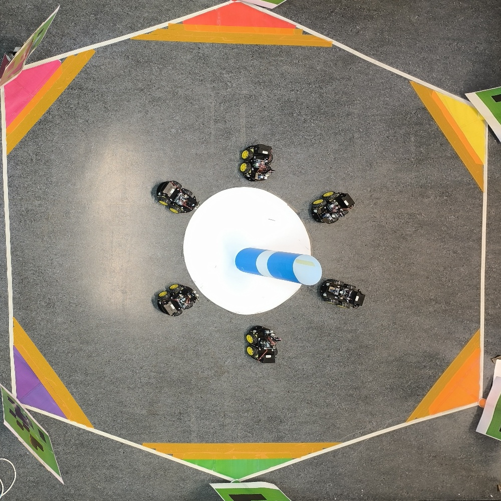

+++
title = "Investigating the Emergence of Self-Organized Hierarchies in Neural Network–Driven Robotic Matter"
summary = "Master's Thesis | Arnold Sommerfeld Center for Theoretical Physics, Ludwig-Maximilians-Universität | October 2025 - Present"
draft = false
weight = 10
showtoc = false
+++

#### Master's Thesis | [Rulands Group](https://www.theorie.physik.uni-muenchen.de/lsfrey/group_rulands/index.html), [Arnold Sommerfeld Center for Theoretical Physics](https://www.theorie.physik.uni-muenchen.de/index.html), Ludwig-Maximilians-Universität | March 2025 - Present 

#### Mentor: [Prof. Dr Steffen Rualnds](https://www.theorie.physik.uni-muenchen.de/lsfrey/members/group_leaders/steffen_rulands/index.html) & [Onurcan Bektas](https://www.theorie.physik.uni-muenchen.de/lsfrey/members/phd_postdocs/onurcan_bektas/index.html)

## Escaping the Plasticity–Memory Dilemma in Intelligent Robotic Systems

Investigated how collective behaviour and task specialisation can emerge in interacting learning agents, addressing the fundamental trade-off between the ability to learn new tasks (plasticity) and retain previously acquired knowledge (memory).

**Theoretical Physics and Stochastic Modelling**
- Developed a performance-dependent suppression mechanism in which competing agents gate each other's access to learning opportunities, allowing task specialisation to emerge through local interactions rather than explicit task allocation.
- Formulated the learning dynamics using stochastic processes and event-driven methods, including Gillespie simulations and tau-leaping, to investigate collective learning, competition and reorganisation.
- Analysed the emergence of specialised configurations and the conditions governing the distribution of tasks across an interacting ensemble.

**Experimental Robotics and Multi-Agent Systems**
- Designed and implemented a physical multi-robot experimental platform using ESP32-based mobile robots to investigate self-organised specialisation in a foraging environment.
- Integrated neural network-based resource classification, computer vision, AprilTag detection, sensor systems and wireless communication to coordinate robot perception and navigation.
- Conducted experiments with six robots performing six distinct tasks, demonstrating the emergence of stable task preferences through performance-dependent interactions without explicitly assigning roles to individual robots.

**Active Matter and Collective Dynamics**
- Developed an active-matter model that coarse-grains neural-network learning into continuous dynamics in a multidimensional performance space, coupled to discrete internal task states.
- Incorporated active propulsion, stochastic fluctuations, relaxation dynamics and state-dependent switching to investigate the physical mechanisms underlying collective specialisation.
- Constructed phase diagrams and investigated system-size scaling to characterise different collective dynamical regimes.
- Demonstrated the model's ability to reproduce stable specialisation and collective reorganisation when new tasks are introduced, providing a physics-based framework for studying the interplay between memory, plasticity and emergent division of labour.

Thesis can be found: [here](/research/thesis.pdf)

Experimental configuration with six robots and 6 resource foraging tasks. 